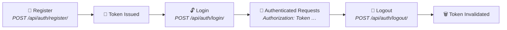

<div align="center">

# 🍲 SeGizi E-Recipes API

[](https://www.python.org/)
[](https://www.djangoproject.com/)
[](https://www.django-rest-framework.org/)
[](https://www.mysql.com/)
[](#)

*A RESTful API engine for discovering, creating, bookmarking, and reviewing recipes with fine-grained role-based access control.*

`20+` REST Endpoints &nbsp;·&nbsp; `8` Core Models &nbsp;·&nbsp; `4` Access Roles &nbsp;·&nbsp; `MySQL 8` Ready

---

[Key Features](#-key-features) •
[Tech Stack](#-tech-stack) •
[Architecture](#-architecture) •
[Quick Start](#-quick-start) •
[Environment](#-environment-variables) •
[Roles](#-accounts--roles) •
[Auth Flow](#-authentication-flow) •
[API Reference](#-api-reference) •
[Playbook](#-developer-playbook)

---
</div>

## 📌 Key Features

| 🔐 **Role-Based Access Control** | 📖 **Recipe Management** |
| :--- | :--- |
| Distinct permissions for **Guest**, **Member**, **Recipe Creator**, and **Admin** users. | Create, update, search, and filter recipes by title, ingredients, prep/cook time, and difficulty. |
| ⭐ **Community Engagement** | 🛡️ **Security First** |
| Bookmark recipes and write reviews with 1–5 star ratings. | Token-based authentication, CORS, CSRF protection, and environment secret handling. |
| 💾 **Database Utilities** | 🧪 **Continuous Integration** |
| Automated PowerShell backup & restore scripts with SHA-256 integrity verification. | GitHub Actions pipeline for linting, migration checks, unit tests, and security audits. |

---

## 🧱 Tech Stack

| Layer | Technology | Purpose |
| :--- | :--- | :--- |
| 🐍 **Framework** | [Django 5.2](https://www.djangoproject.com/) | Web framework, ORM & admin panel |
| 🌐 **API** | [Django REST Framework](https://www.django-rest-framework.org/) | Serialization, filtering & browsable API |
| 🐬 **Database** | [MySQL 8.0](https://www.mysql.com/) | Relational storage with `utf8mb4` support |
| 🔑 **Authentication** | DRF Token Auth | Stateless token-based authentication |
| ⚡ **Cache** | [Redis](https://redis.io/) + django-redis | Caching & API rate-limiting backend |
| 📦 **Static Files** | [WhiteNoise](https://whitenoise.readthedocs.io/) | Efficient static file serving |
| 🚀 **Server** | [Gunicorn](https://gunicorn.org/) | Production WSGI server |
| 🔧 **Configuration** | [python-dotenv](https://pypi.org/project/python-dotenv/) | `.env` based secret management |

---

## 🧭 Architecture

```text
┌───────────────────────────────────────────────────────────┐
│                          CLIENTS                          │
│              Browser · Mobile · Postman · curl            │
└─────────────────────────────┬─────────────────────────────┘
                              │  HTTP + Authorization: Token
                              ▼
┌───────────────────────────────────────────────────────────┐
│                    DJANGO 5.2 · DRF API                   │
│      Views ─ Serializers ─ Permissions (RBAC) ─ Admin     │
└────────┬────────────────────────────────────────────────┬─┘
         │ ORM                                            │ cache
         ▼                                                ▼
┌─────────────────┐                            ┌─────────────────┐
│   MySQL 8.0     │                            │  Redis (opt.)   │
│   db_e-resep    │                            │ cache · limits  │
└─────────────────┘                            └─────────────────┘
```

---

## 📂 Repository Layout

```text
.
├── backend/                  # Django REST Framework backend application
│   ├── config/               # Project configuration & settings
│   ├── recipes/              # Core app: Models, API endpoints, permissions, tests
│   ├── manage.py             # Django CLI runner
│   └── requirements.txt      # Python dependencies
├── frontend/                 # Client workspace (Reserved for future frontend build)
├── scripts/                  # Automated PowerShell MySQL backup and restore scripts
├── .env.example              # Environment variables template
├── .gitignore                # Git exclusions
└── README.md                 # Project documentation
```

> ℹ️ **Note:** The current project is a backend-focused Django REST API service.

---

## ⚡ Quick Start

### 📋 Prerequisites

- **Python:** 3.10+ (compatible with Django 5.2)
- **Database:** MySQL 8.0+
- **Shell:** Windows PowerShell or Command Prompt / Bash

---

### 🚀 Setup Steps

#### 1️⃣ Activate or Create Virtual Environment

**PowerShell:**
```powershell
# Activate existing environment
.\venv\Scripts\Activate.ps1

# Or create a new environment if needed
py -m venv venv
.\venv\Scripts\Activate.ps1
```

**Command Prompt:**
```cmd
venv\Scripts\activate.bat
```

#### 2️⃣ Install Dependencies

```powershell
python -m pip install -r .\backend\requirements.txt
```

#### 3️⃣ Environment Configuration

Copy the template file to `.env`:

```powershell
Copy-Item .\.env.example .\.env
```

Edit your local `.env` file to set your MySQL database credentials and settings.

Create the MySQL database on your local MySQL server:

```sql
CREATE DATABASE `db_e-resep`
  CHARACTER SET utf8mb4
  COLLATE utf8mb4_unicode_ci;
```

#### 4️⃣ Apply Migrations & Create Administrator

```powershell
python .\backend\manage.py migrate
python .\backend\manage.py createsuperuser
```

#### 5️⃣ Launch Development Server

```powershell
python .\backend\manage.py runserver
```

| Service | URL |
| :--- | :--- |
| 🌐 **API Root** | `http://127.0.0.1:8000/api/` |
| 🛠️ **Admin Panel** | `http://127.0.0.1:8000/admin/` |
| 🩺 **Health Check** | `http://127.0.0.1:8000/api/health/` |

---

## 🔧 Environment Variables

| Variable | Local Development | Production | Description |
| :--- | :--- | :--- | :--- |
| `DJANGO_DEBUG` | `True` | `False` | Enables debug mode & detailed errors |
| `DJANGO_SECRET_KEY` | Temporary key | Strong Private Key | Cryptographic key for session security |
| `DJANGO_ALLOWED_HOSTS` | `localhost` | `api.yourdomain.com` | Allowed request Host headers |
| `DB_NAME` | `db_e-resep` | Production DB Name | Name of the MySQL database |
| `DB_USER` | `root` / user | Production DB User | Database username |
| `DB_PASSWORD` | Local Password | Secret Password | Database password |
| `DB_HOST` | `localhost` | Host IP / Domain | MySQL database host |
| `DB_PORT` | `3306` | `3306` | MySQL port number |
| `CACHE_URL` | Local Memory | Redis URL | Cache & Rate limit backend |
| `CORS_ALLOWED_ORIGINS` | `http://localhost:5173` | Trusted Origins | Permitted cross-origin origins |
| `CSRF_TRUSTED_ORIGINS`| `http://localhost:5173` | Trusted Origins | Trusted CSRF origins |

---

## 👥 Accounts & Roles

| Role | Capabilities |
| :--- | :--- |
| 👤 **Guest** | Search & view approved recipes, categories, and ingredients. |
| 👤 **Member** | Register, log in, bookmark recipes, and write reviews. |
| 🧑‍🍳 **Recipe Creator** | All Member features + create, edit, and delete own recipes. |
| 🛡️ **Admin** | Full system control: Manage users, roles, categories, and approve recipes. |

### Role Management Snippets

<details>
<summary><b>Grant Creator Access (Admin Only)</b></summary>

`PATCH /api/users/{id}/`
```json
{
  "role": "creator"
}
```
*(Accepts: `member`, `creator`, `admin`)*
</details>

<details>
<summary><b>Approve Recipe (Admin Only)</b></summary>

`PATCH /api/recipes/{id}/`
```json
{
  "is_approved": true
}
```
</details>

---

## 🔑 Authentication Flow



### 1. Register Account

- **Endpoint:** `POST /api/auth/register/`
- **Request Body:**
```json
{
  "username": "recipe_fan",
  "email": "recipe_fan@example.com",
  "password": "choose-a-strong-password",
  "password_confirm": "choose-a-strong-password"
}
```
*Returns user profile and API authentication token.*

### 2. Login

- **Endpoint:** `POST /api/auth/login/`
- **Request Body:**
```json
{
  "username": "recipe_fan",
  "password": "choose-a-strong-password"
}
```

### 3. Authenticated Requests

Include token header in protected requests:
```http
Authorization: Token <your-auth-token>
```

### 4. Logout

- **Endpoint:** `POST /api/auth/logout/` *(Requires Auth Header)*

---

## 📖 API Reference

<details open>
<summary><b>Common API Actions</b></summary>

<br>

**1. Create a Recipe (Creator Role)**

- **Endpoint:** `POST /api/recipes/`
- **Headers:** `Authorization: Token <token>`

```json
{
  "title": "Soto Ayam",
  "description": "A comforting chicken soup.",
  "category": 1,
  "prep_time": 20,
  "cook_time": 40,
  "servings": 4,
  "difficulty": "Mudah"
}
```
*Note: To attach an image, use `multipart/form-data`.*

**2. Bookmark a Recipe (Member Role)**

- **Endpoint:** `POST /api/bookmarks/`

```json
{
  "recipe": 42
}
```

**3. Review & Rate a Recipe (Member Role)**

- **Endpoint:** `POST /api/reviews/`

```json
{
  "recipe": 42,
  "rating": 5,
  "comment": "Easy to follow and delicious."
}
```

</details>

---

### 🚦 Route Directory

All routes are prefixed with `/api/`. Paginated lists default to 20 items per page.

#### 🔐 Authentication & System

| Route | Access | Purpose |
| :--- | :--- | :--- |
| `/` | Public | API Root Landing Page |
| `/login/` | Public | Browser authentication form |
| `/api/health/` | Public | System and DB health check |
| `/api/auth/register/` | Public | Register new user account |
| `/api/auth/login/` | Public | Obtain authentication token |
| `/api/auth/logout/` | Authenticated | Invalidate authentication token |

#### 🍲 Recipes & Catalog

| Route | Access | Purpose |
| :--- | :--- | :--- |
| `/api/recipes/` | Public Read / Auth Write | Search, list, and create recipes |
| `/api/recipes/{id}/` | Public Read / Owner Write | View, update, or delete recipe |
| `/api/categories/` | Public Read / Admin Write | List & manage recipe categories |
| `/api/ingredients/` | Public Read / Admin Write | List & manage ingredient items |
| `/api/recipe-ingredients/` | Creator / Admin | Manage ingredients list per recipe |
| `/api/steps/` | Creator / Admin | Manage step-by-step instructions |

#### ⭐ Community & Administration

| Route | Access | Purpose |
| :--- | :--- | :--- |
| `/api/bookmarks/` | Authenticated | List & manage user bookmarks |
| `/api/reviews/` | Authenticated | Read & post recipe reviews |
| `/api/users/` | Admin | Manage user accounts and roles |

---

### 🔍 Search & Filtering Examples

```text
GET /api/recipes/?search=chicken
GET /api/recipes/?category=dinner&max_prep_time=30&ordering=-created_at
GET /api/recipes/?difficulty=Mudah&min_cook_time=15
```

| Parameter | Example | Description |
| :--- | :--- | :--- |
| `search` | `?search=chicken` | Search across recipe text fields |
| `category` | `?category=dinner` | Filter by category |
| `difficulty` | `?difficulty=Mudah` | `Mudah` · `Sedang` · `Sulit` |
| `min_prep_time` / `max_prep_time` | `?max_prep_time=30` | Prep time range in minutes |
| `min_cook_time` / `max_cook_time` | `?min_cook_time=15` | Cook time range in minutes |
| `ordering` | `?ordering=-created_at` | Sort result (prefix `-` = descending) |

---

## 💻 Developer Playbook

### 🧪 Diagnostics & Testing

| Task | Command |
| :--- | :--- |
| 🩺 System check | `python .\backend\manage.py check` |
| 🗃️ Pending migrations | `python .\backend\manage.py makemigrations --check --dry-run` |
| 🧪 Run test suite | `python .\backend\manage.py test recipes` |
| 🔒 Security verification (production readiness) | `python .\backend\manage.py check --deploy` |

---

### 💾 Backup & Database Management

PowerShell backup scripts with SHA-256 checksum validation:

```powershell
# Execute database backup
.\scripts\backup_mysql.ps1

# Restore from a backup file
.\scripts\restore_mysql.ps1 -BackupFile .\backups\db_e-resep_YYYYMMDD_HHMMSS.sql
```

---

### 🔒 Security & Deployment Checklist

- [ ] Set `DJANGO_DEBUG=False` in production.
- [ ] Generate a secure, unique `DJANGO_SECRET_KEY`.
- [ ] Configure `DJANGO_ALLOWED_HOSTS`, `CORS_ALLOWED_ORIGINS`, and `CSRF_TRUSTED_ORIGINS`.
- [ ] Use Redis for shared cache and rate-limiting (`CACHE_URL`).
- [ ] Serve behind a WSGI server (Gunicorn) with HTTPS/TLS proxying.

---

<div align="center">

**🍲 SeGizi E-Recipes API** — Built with ❤️ for SeGizi E-Recipes

[⬆ Back to Top](#-segizi-e-recipes-api)

</div>
